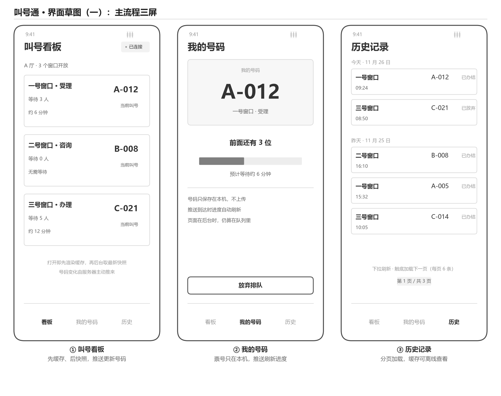

# 叫号通 —— Flutter 实时排队原型

Flutter 移动应用开发实训第 11 课「网络访问与异步交互」课程原型。
以叫号看板为载体，串联 **HTTP 快照 + WebSocket 推送** 双通道：
HTTP 负责首屏渲染，WebSocket 负责实时叫号变化，两条通道在同一界面汇合、同一份状态收敛。

---

## 界面预览

| 叫号看板 | 我的号码 | 我的 |
|---|---|---|
|  |  |  |

HTML 原型（Material 3 精修版）：[`prototype/index.html`](prototype/index.html)
双击即可在浏览器里打开，**底部两条调试切换条**可逐屏核对 HTTP 六态 × WebSocket 三态的所有表现。

## 下载安装

> 仓库路径含中文（`Desktop\网络访问`）导致 AOT snapshotter 无法编译 release APK，故提供 **debug 构建**。
> 功能完全一致，调试包体积稍大，真机可直接安装运行。

**扫码下载 Android 版**（微信拦截 → 右上角「在浏览器打开」）：

| 主流手机 arm64 | 老款手机 arm |
|---|---|
| [](dist/wlfw-arm64-debug.apk) | [](dist/wlfw-arm-debug.apk) |
| **78.7 MB** · 小米/华为/OPPO/vivo 新机型 | **58.7 MB** · 32 位老机型 / 模拟器 |

也可以直接点链接下载：
- [`wlfw-arm64-debug.apk`](dist/wlfw-arm64-debug.apk)（arm64-v8a，推荐）
- [`wlfw-arm-debug.apk`](dist/wlfw-arm-debug.apk)（armeabi-v7a）

安装步骤：
1. 扫上面对应二维码，或用手机浏览器点下载链接
2. 微信拦截下载 → 右上角菜单「在浏览器打开」
3. 系统提示"未知来源"→ 允许本次安装
4. 安装完成后打开，默认读本地 mock 数据，不连真实网络

## 功能

- **双通道架构**：`FutureBuilder`（HTTP 列表快照）+ `StreamBuilder`（WebSocket 推送）同页协同，HTTP 决定骨架视图、推送只 patch 单行叫号大字，不整页重建。
- **三态齐全**：加载中（转圈）/ 出错（网络·超时·HTTP xxx 三分类文案 + 重试按钮）/ 空数据（图标主色·不叫报错·无按钮）。
- **实时可恢复**：WebSocket 断开后界面 **保留最后一次快照 + 整体降对比度**，顶部离线 banner 标注"实时更新已断开，显示的是最后一次快照"，与空态观感彻底不同。指数退避重连 + 重连成功后主动拉一次 HTTP 快照补齐。
- **缓存先旧后新**：冷启动先读缓存渲染，后台发请求覆盖缓存并刷新；请求失败时缓存继续顶住，离线 banner 标注。
- **错误三分类**：SocketException → "请检查网络连接" / TimeoutException → "请求超时，请稍后再试" / HTTP 非 2xx → "服务异常：HTTP xxx"；文案在 `AppException` 层统一归口，页面层不写 try/catch。
- **下拉刷新 & 触底分页**：`RefreshIndicator` + 8dp 阈值防重复，`hasMore` 标志判断是否还有下一页。
- **字段兜底**：`Window.fromJsonSafe` 对缺失字段全部给默认值，推送里一条脏消息不连累整页。

## 数据模型

```dart
class Window {
  final String id;              // 空字符串 → list 层丢弃
  final String name;            // null → '未命名窗口'
  final String currentNumber;   // null → '未叫号'
  final int waitingCount;       // null → 0
  final int updatedAt;          // null → 0
}

class Ticket {
  final String ticketNo;
  final String windowId;
  final int aheadCount;
  final String issuedAt;
}
```

接口契约与消息队列设计详见课程方案文档 [`docs/网络访问与异步交互App开发方案.docx`](docs/网络访问与异步交互App开发方案.docx)。

## 快速开始

### HTML 原型（零依赖）

```bash
# 直接打开（Windows）
start prototype\index.html
# 或起个静态服务
python -m http.server 8080 -d prototype
```

浏览器底部的调试切换条可手动制造故障：
- **HTTP 快照**：加载中 / 正常 / 断网 / 超时 / HTTP 500 / 空数据
- **实时通道**：已连接 / 重连中 / 已断开

### Flutter 实现（即将补充）

```bash
flutter create .
flutter pub get
flutter run
```

运行前确认 `constants.dart` 里的 HTTP 与 WebSocket 端点指向课堂发布地址，接口地址**集中在一个常量文件**里便于合规核查。

## 项目结构

```
.
├── prototype/           # HTML 原型（Material 3，纯 HTML/CSS/JS）
│   └── index.html
├── docs/                # 课程方案与开发文档
│   └── 网络访问与异步交互App开发方案.docx
├── screenshots/         # 界面截图与线框
│   └── wireframe_v1.png
├── lib/                 # Flutter 工程（待补充）
│   ├── core/
│   │   ├── api_client.dart    # 请求五要素
│   │   ├── app_exception.dart # 错误三分类
│   │   └── constants.dart     # URL 集中常量
│   ├── models/
│   │   ├── window.dart        # Window.fromJsonSafe 兜底
│   │   └── ticket.dart
│   ├── repository/
│   │   └── board_repository.dart
│   ├── services/
│   │   ├── ws_service.dart    # 连接/监听/心跳/重连
│   │   └── cache_service.dart # 先旧后新三步走
│   ├── pages/
│   │   ├── board_page.dart    # FutureBuilder 三态 + 推送 patch
│   │   ├── ticket_page.dart
│   │   └── mine_page.dart
│   └── widgets/
│       ├── state_views.dart   # LoadingView / ErrorView / EmptyView
│       ├── offline_banner.dart
│       └── window_tile.dart
└── README.md
```

## 合规与隐私

- **数据来源唯一基准**：只访问课堂发布的 HTTP 与 WebSocket 端点，地址集中在 `constants.dart`，全局搜索 `http` 只出现在该文件。
- **用户数据最小化**：只取叫号所需的窗口名/当前号/等待人数，不申请位置、通讯录、相册权限。
- **隐私红线**：不采集、不上传手机号与位置；票号仅存本机、可一键清除；本地缓存只存公开快照，不包含任何个人信息。

详细合规声明见 App 内 "我的 → 数据来源与合规" 页面。

## 验收故障注入清单

提交前逐条过一遍，任何一项不通过不算完成：

| 注入方式 | 期望结果 |
|---|---|
| 飞行模式 + 刷新 | "请检查网络连接"，重试按钮可点 |
| 弱网 / 代理延迟 | "请求超时，请稍后再试"，8 秒内有结论 |
| 请求不存在路径 | "服务异常：HTTP 404"，不解析、不写缓存 |
| 空数据端点 | EmptyView，不白屏、不报错，显示"当前没有开放的窗口" |
| 关闭 WebSocket 服务端 | 5 秒内进入重连，界面标注实时中断，原内容保留并降对比度 |
| 重复推送同一条 | 界面结果与只收到一次相同 |

## 后续演进

| 优先级 | 动作 |
|---|---|
| P0 | 补全 Flutter 工程（当前只有 HTML 原型） |
| P1 | 接口层换 dio，加统一日志与重试拦截器 |
| P2 | 缓存引入 ETag / Last-Modified，软过期升级为条件请求 |
| P3 | 推送增加消息队列式补偿，支持断线期间事件回放 |
| P4 | 接入系统推送通道，离开 App 也能收到叫号提醒 |

## 许可

课程原型，非商业用途。
